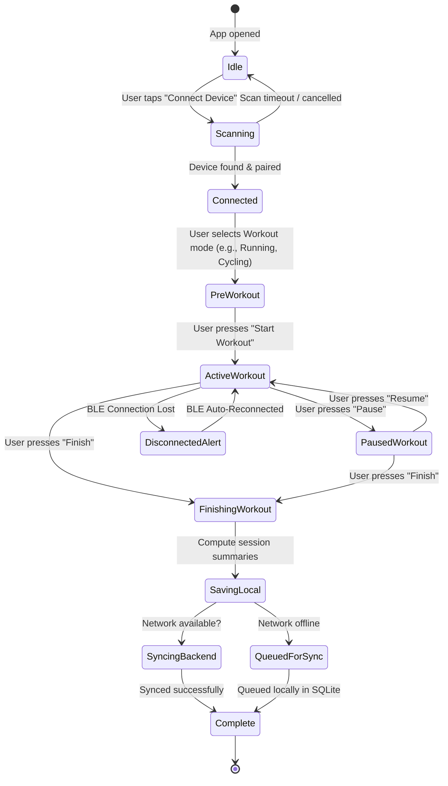

# PRAANA — System Architecture & Technical Blueprint

---

## 1. System Overview & Component Diagram

PRAANA separates hardware communication from UI and analytics using an event-driven, decoupled architecture.

```mermaid
graph TD
    subgraph Wearable Hardware Tier
        PhysicalSensor["Physical PRAANA Sensor (Pending Specs)"]
    end

    subgraph Mobile Application Tier (React Native / Expo)
        subgraph Hardware Abstraction Layer
            SensorProvider["<<interface>> ISensorProvider"]
            MockProvider["MockSensorProvider (Phase 4)"]
            BleProvider["BleSensorProvider (Phase 8 - Future)"]
        end

        subgraph State & Business Logic
            WorkoutManager["Workout Session Engine"]
            MetricsProcessor["Local Real-Time Processor (SQI, HR, Respiration)"]
            LocalStore["Offline Storage & Sync Queue (WatermelonDB / SQLite)"]
        end

        subgraph Presentation Layer (Expo Router)
            Screens["Mobile UI Screens (Dashboard, Live Workout, History, Trends)"]
        end
    end

    subgraph Backend Services Tier (Node.js / Express / MongoDB)
        API["Express REST API (Auth, Sessions, Batch Ingestion)"]
        AnalyticsEngine["Analytical Engine (VO2 Max, TRIMP Load, VT1/VT2)"]
        Database[("MongoDB: Users, Devices, Sessions, Samples")]
    end

    PhysicalSensor -.->|"BLE GATT Telemetry (Future)"| BleProvider
    MockProvider -.->|"Simulated 1Hz-10Hz Telemetry"| SensorProvider
    BleProvider -.->|"Parsed Telemetry"| SensorProvider
    SensorProvider -->|"Normalized Samples"| WorkoutManager
    WorkoutManager -->|"Real-Time Stream"| Screens
    WorkoutManager -->|"Real-Time Metrics"| MetricsProcessor
    WorkoutManager -->|"Persist Session & Samples"| LocalStore
    LocalStore -->|"Idempotent Batch Sync (JSON)"| API
    API --> Database
    API --> AnalyticsEngine
```

---

## 2. Decoupled Hardware Abstraction Layer

A core architectural pattern in PRAANA is the **SensorProvider Abstraction**. 
The UI layer and workout state machines never import Bluetooth libraries directly. Instead, they interact with an abstract TypeScript interface:

```typescript
export interface ISensorProvider {
  id: string;
  name: string;
  connectionState: 'disconnected' | 'scanning' | 'connecting' | 'connected' | 'error';
  
  // Lifecycle
  connect(deviceId?: string): Promise<void>;
  disconnect(): Promise<void>;
  
  // Streaming subscriptions
  onSample(callback: (sample: SensorSample) => void): () => void;
  onStatusChange(callback: (status: DeviceStatus) => void): () => void;
  
  // Device controls
  sendHapticAlert?(pattern: 'low' | 'medium' | 'high'): Promise<void>;
}
```

- In **Phase 4**, we implement `MockSensorProvider`, generating mathematically sound, physiologically correlated telemetry (e.g. rising breathing rate and heart rate under simulated exertion).
- In **Phase 8**, when the hardware team specifies UUIDs and packet formats, we implement `BleSensorProvider` adhering to the exact same contract. **Zero UI code changes are needed when switching to physical hardware.**

---

## 3. Normalized Measurement Data Architecture

To ensure consistency across mock data, live BLE streaming, offline caching, and backend database storage, all metric samples adhere to a standardized normalized format:

```typescript
export interface SensorSample {
  sampleId: string;             // UUID or device sequence number
  sessionId: string;            // Workout session ID
  userId: string;               // User identifier
  timestamp: number;            // UTC Epoch milliseconds
  metric: 'heart_rate' | 'respiration_rate' | 'ecg_raw' | 'rr_interval' | 'cadence' | 'body_shock';
  value: number;                // Numeric scalar reading
  unit: 'bpm' | 'brpm' | 'mv' | 'ms' | 'spm' | 'g';
  status: 'raw' | 'derived' | 'estimated';
  signalQuality: 'good' | 'degraded' | 'invalid';
  sequenceNumber?: number;      // Monotonically increasing counter to detect radio dropouts
}
```

### High-Frequency Raw Signals vs. Summary Aggregates
- **Raw Stream (10 Hz – 250 Hz):** Kept in an in-memory ring buffer on the mobile device for smooth live charts (e.g., ECG or breathing trace) and stored in local device storage.
- **Aggregated Summaries (1 Hz or per-second / per-minute rolling averages):** Streamed or batch-synced to the backend to conserve battery, bandwidth, and database storage.

---

## 4. Mobile Screen Map & Navigation Hierarchy

Using **Expo Router** (file-based navigation in `apps/mobile/app/`):

```
apps/mobile/app/
├── _layout.tsx                     # Root layout (Auth check, theme provider, global fonts)
├── (auth)/                         # Authentication route group
│   ├── welcome.tsx                 # Welcome screen & value proposition
│   ├── login.tsx                   # Email/Password login
│   ├── register.tsx                # New account registration
│   └── onboarding.tsx              # Athletic profile (Age, resting HR, fitness level)
├── (tabs)/                         # Main bottom tab navigator
│   ├── _layout.tsx                 # Tab bar configuration
│   ├── index.tsx                   # Dashboard (Readiness, weekly load, recent workout)
│   ├── workout/                    # Workout tab
│   │   ├── index.tsx               # Workout launchpad & activity selector
│   │   └── live.tsx                # Live workout screen (Real-time telemetry & controls)
│   ├── history/                    # History tab
│   │   ├── index.tsx               # Chronological workout list
│   │   └── [id].tsx                # Detailed workout session inspection & charts
│   ├── devices.tsx                 # Device scanning, BLE pairing & battery status
│   └── settings.tsx                # Data privacy, export, sync controls, units
└── workout-summary.tsx             # Post-workout debrief modal (TRIMP, VT1/VT2 estimates)
```

---

## 5. End-to-End Workout Lifecycle State Machine



---

## 6. Monorepo Repository Structure

```
praana-platform/
├── apps/
│   ├── mobile/                    # React Native Expo App (TypeScript)
│   │   ├── app/                   # Expo Router file-based screens
│   │   ├── src/
│   │   │   ├── components/        # Reusable UI components (Buttons, Cards, Metrics)
│   │   │   ├── core/              # Design tokens, theme, typography, spacing
│   │   │   ├── providers/         # SensorProvider interfaces & implementations
│   │   │   ├── hooks/             # Custom hooks (useWorkout, useSensor, useAuth)
│   │   │   ├── storage/           # Local SQLite / MMKV / secure storage
│   │   │   └── types/             # Shared TypeScript models
│   │   ├── package.json
│   │   └── app.json
│   │
│   └── backend/                   # Node.js + Express + TypeScript API
│       ├── src/
│       │   ├── config/            # DB connection, env validation
│       │   ├── controllers/       # Route controllers (Auth, Sessions, Devices)
│       │   ├── middleware/        # JWT auth, error handlers, request validation
│       │   ├── models/            # Mongoose schemas (User, Session, Sample, Device)
│       │   ├── routes/            # REST API route definitions
│       │   └── services/          # Sports physiology algorithms (TRIMP, VO2, VT1/VT2)
│       ├── package.json
│       └── tsconfig.json
│
├── docs/                          # Architectural documentation & specifications
│   ├── ARCHITECTURE.md            # System blueprint (This file)
│   ├── HARDWARE_QUESTIONNAIRE.md  # BLE & Sensor specs questionnaire
│   ├── METRICS_SPECIFICATION.md   # Measured vs Estimated metrics taxonomy
│   └── DATA_PRIVACY_AND_RETENTION.md # Privacy, ownership & security rules
│
└── package.json                   # Root workspace package.json
```
